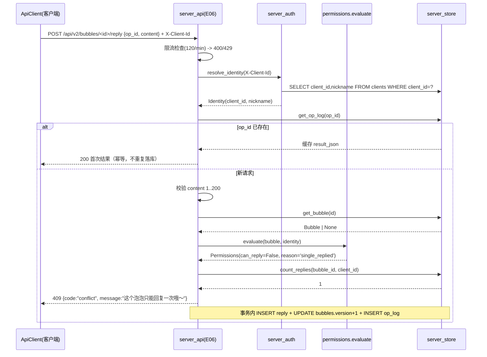
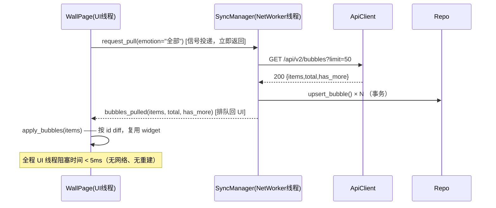
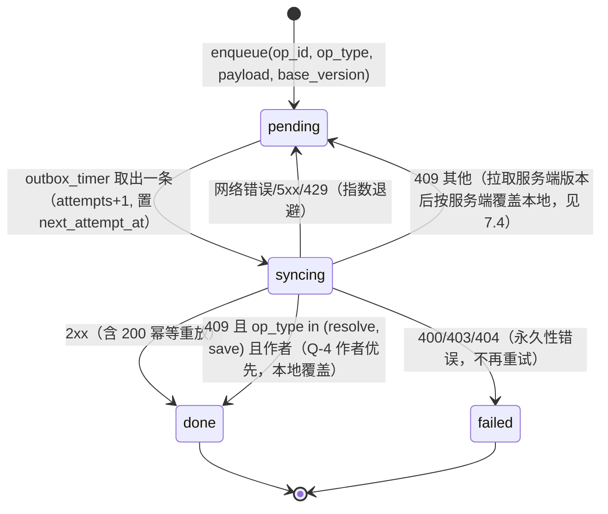
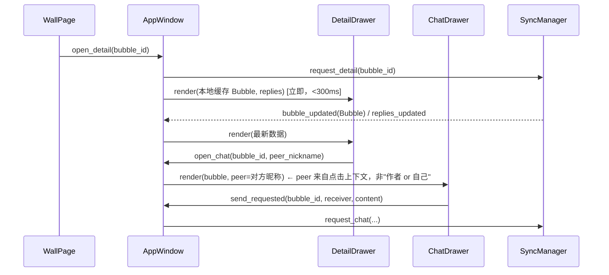

# 情缘 v2.0 — 系统架构设计

> 架构师：高见远
> 依据：`DOCS/v2/00_审计报告.md` + `01_PRD_v2.md`（R-01~R-20）+ `01b_产品决策裁定.md`（Q-1~Q-4 已定，不再讨论）+ `02_视觉规格.md`
> 状态：可直接交付工程师实现（设计冻结）
> 本文只写设计，不含实现代码。代码块均为接口签名 / DDL / 契约。

---

## 0. 设计前提（实测确认，非假设）

| 项 | 实测结果 |
|---|---|
| Python | 3.12.10（`python.exe`） |
| 已装依赖 | PyQt5 5.15.11 / PyQt5-Qt5 5.15.2 / PyQt5-sip 12.18.0 / Flask 3.1.3 / Werkzeug 3.1.8 / Jinja2 3.1.6 / click 8.4.2 / itsdangerous 2.2.0 / blinker 1.9.0 / requests 2.34.2 / waitress 3.0.2 |
| 未装 | pytest（**禁止引入**，测试用标准库 `unittest`） |
| 客户端库 | `~/.Qingyuan/qingyuan.db`：`bubbles`(6 行，`author_node_id` 在**末尾**)、`replies`(0)、`chat_messages`(0)、**遗留 `users` 表**（`nickname UNIQUE`，旧 Web 分支残留） |
| 服务端库 | `server_data/qingyuan_server.db`：`bubbles`(5 行，`author_node_id` 在第 3 列)、`replies`(1)、`chat_messages`(2) |
| 列序冲突根因 | 两端 `bubbles` 列序不同 + `SELECT *` + 位置下标 → `row[2..6]` 全错位 |
| 离屏渲染 | `QT_QPA_PLATFORM=offscreen` 下**无字体**，截图只能验几何，不能验文字 |

**结论：旧库必须走"建新表 → 按列名拷贝 → 换表"，且两端列序强制统一为同一顺序。**

---

## 1. 分层与目录结构

### 1.1 分层原则

| 层 | 目录 | 职责 | 硬规则 |
|---|---|---|---|
| L0 基础设施 | `src/core/`（config/constants/logging_setup/errors/timeutil） | 配置、常量、日志、错误、时间格式 | 不 import PyQt5、不 import Flask |
| L1 数据 | `src/core/models.py` `repo.py` `migrations.py` | 具名结构、客户端仓储、DDL 与迁移 | **禁止 `SELECT *`、禁止位置下标** |
| L2 领域/规则 | `src/core/permissions.py` | 权限判定的**唯一实现**，服务端与客户端共用 | 纯函数，无 IO |
| L3 传输/同步 | `src/core/api.py` `outbox.py` `sync.py` | HTTP 出口、离线队列、同步协调 | **只有这里能 import requests** |
| L4 服务端 | `src/server_app.py` `server_store.py` `server_auth.py` `server_api.py` | Flask app 工厂、服务端仓储、身份、路由 | 服务端不 import `src/ui/**` |
| L5 界面 | `src/ui/**` | 页面、组件、动画 | **禁止 import requests、禁止写数据库、禁止裸 except** |
| L6 测试 | `tests/**` | unittest | 批次 A 测试不得 import PyQt5 |

> 为什么把 `permissions.py` 放 core 而不是 server：PRD 第 7 节第 2 条要求"权限只算一次"。同一份判定被服务端（权威）与客户端（离线兜底）调用，避免两套规则漂移。

### 1.2 目标文件树

```
情缘项目/
├── server.py                      # 入口（不变）：waitress 启动 src.server_app:app
├── requirements.txt               # 精确版本锁定（见 §10）
├── .gitignore                     # 排除 __pycache__/ *.log *.db 密钥，但放行 tests/fixtures/*.db
├── 启动软件.bat                    # 一键启动：chcp 65001 + 相对路径 + where python 查找
├── config/                        # 保留但本次不读取（secrets.local.py 已列入 .gitignore）
├── server_data/
│   ├── qingyuan_server.db   # 服务端库（迁移目标）
│   └── backup/                    # 迁移前文件级备份（只写不删）
├── src/
│   ├── __init__.py
│   ├── main.py                    # 客户端入口（不变）：建 QApplication → AppWindow
│   ├── core/
│   │   ├── __init__.py
│   │   ├── constants.py           # 情感/状态/模式枚举、长度上限、轮询间隔（唯一来源）
│   │   ├── config.py              # 路径解析 + config.json 读写（client_id/token/server_url/nickname）
│   │   ├── logging_setup.py       # RotatingFileHandler(5MB) + 统一格式 + install_excepthook
│   │   ├── errors.py              # AppError 家族（见 §11）
│   │   ├── timeutil.py            # now_iso() / fmt_display() / parse_iso()（时间格式唯一出口）
│   │   ├── models.py              # Bubble/Reply/ChatMessage/OutboxItem + row_to_* 转换
│   │   ├── migrations.py          # 客户端 DDL + 旧库无损迁移（Migrator）
│   │   ├── repo.py                # 客户端仓储（只读查询 + 写入 API，具名返回）
│   │   ├── permissions.py         # evaluate() 权限判定唯一实现
│   │   ├── api.py                 # ApiClient（requests 唯一使用者）+ ApiResult
│   │   ├── outbox.py              # Outbox 仓储 + 状态机 + 退避
│   │   └── sync.py                # SyncManager(QObject)：拉取/入队/重放/在线探测
│   ├── server_app.py              # Flask app 工厂 + 蓝图注册 + 限流 + 统一错误处理 + app 全局
│   ├── server_store.py            # 服务端 DDL/迁移 + 仓储（分页、幂等、版本）
│   ├── server_auth.py             # X-Client-Id 登记、token 校验、当前请求方解析
│   ├── server_api.py              # /api/v2/* 蓝图 + /api/* 兼容适配层
│   └── ui/
│       ├── __init__.py
│       ├── theme.py               # 配色令牌、字体、QSS、EMOTION_COLORS 唯一来源
│       ├── net_worker.py          # NetWorker(QThread) 宿主 + SyncManager 启动/停止（唯一持 QThread 的 UI 文件）
│       ├── widgets/
│       │   ├── __init__.py
│       │   ├── common.py          # GradientPage 基类、Chip、空态、Avatar、气泡消息体
│       │   ├── flow_layout.py     # FlowLayout：自适应列数 + 行内居中 + 错落偏移
│       │   ├── bubble_view.py     # BubbleView：圆形渐变绘制 + 悬停 + 爆破
│       │   ├── animation.py       # BubbleAnimator：单一全局 QTimer 驱动所有泡泡
│       │   ├── drawer.py          # Drawer：右侧抽屉容器（宽 420，圆角只在左侧）
│       │   └── toast.py           # Toast：底部浮出提示（"有 N 个新泡泡"）
│       ├── pages/
│       │   ├── __init__.py
│       │   ├── login_page.py      # 昵称进入（沿用现有交互，修文案）
│       │   ├── wall_page.py       # 泡泡墙：筛选/搜索/分页/新泡泡提示/diff 刷新
│       │   ├── my_page.py         # 我的：我发布的/公开保留/私密保存/已解决
│       │   ├── publish_page.py    # 发布：内容+情感+模式，离线入队
│       │   ├── detail_drawer.py   # 详情抽屉：作者操作区/回复区/权限展示
│       │   └── chat_drawer.py     # 对话抽屉：左右对齐、对方昵称、未回复提示
│       └── app_window.py          # 主窗口：页面栈 + 抽屉叠加 + 信号接线 + 关闭清理
├── tests/
│   ├── __init__.py
│   ├── helpers.py                 # 临时库构造、假 ApiClient、夹具、offscreen 环境变量
│   ├── fixtures/legacy_client.db  # 迁移夹具（当前客户端库副本，6 条记录）
│   ├── fixtures/legacy_server.db  # 迁移夹具（当前服务端库副本，5/1/2）
│   ├── test_models.py             # 行→dataclass、列名映射、错误列序不得错位
│   ├── test_migration.py          # 旧库无损迁移：6 条不丢、字段不错位、列序断言
│   ├── test_repo.py               # CRUD、分页、搜索、我的三组、私密隔离
│   ├── test_server_store.py       # 服务端库迁移（5/1/2 不丢）+ 分页 + op_log 幂等
│   ├── test_permissions.py        # 角色×操作判定表全矩阵
│   ├── test_server_api.py         # 400/403/404/409/429、分页、幂等、旧端点兼容
│   ├── test_sync_outbox.py        # 入队/重放/幂等/退避/冲突（Q-4）
│   ├── test_flow_layout.py        # 列数 2/3/4、无重叠无裁切（offscreen）
│   ├── test_wall_diff.py          # 10 次刷新 widget 身份不变、数量不增长
│   └── test_hygiene.py            # 无裸 except、无 SELECT *、ui 不 import requests、无乱码
└── tools/                         # 现有截图/探针脚本，保留
```

> 文件行数上限 500：`wall_page.py`、`detail_drawer.py` 是高风险点，若超限按"渲染 / 交互"拆为 `wall_page.py` + `wall_grid.py`、`detail_drawer.py` + `detail_sections.py`。

---

## 2. 数据模型

### 2.1 字段表

#### Bubble

| 字段 | 类型 | 可空 | 说明 |
|---|---|---|---|
| `id` | str | 否 | UUID4 或历史 id（`test-pub-001`），主键 |
| `author_nickname` | str | 否 | 展示用昵称，1~12 字 |
| `author_client_id` | str | 否 | 作者设备 ID；**旧数据为空串**（迁移保留空，回退昵称判定） |
| `content` | str | 否 | 正文，1~500 字 |
| `emotion_tag` | str | 否 | 6 个常量之一（`constants.EMOTIONS`） |
| `reply_mode` | str | 否 | `single` \| `dialog` |
| `status` | str | 否 | `active` \| `resolved` \| `saved_public` \| `saved_private` |
| `version` | int | 否 | 服务端每次变更 +1，初始 1（Q-4） |
| `created_at` | str | 否 | `YYYY-MM-DDTHH:MM:SS`（本地时间，见 §11） |
| `resolved_at` | str | 是 | 标记已解决时间 |
| `saved_at` | str | 是 | 公开/私密保留时间（v1 误写入 `resolved_at`，本版分离） |
| `sync_state` | str | 否 | `synced` \| `pending` \| `failed`（**仅客户端**） |
| `reply_count` | int | 否 | 计算字段，来自 `LEFT JOIN replies`，非数据库列 |
| `chat_count` | int | 否 | 计算字段，非数据库列 |

#### Reply

| 字段 | 类型 | 可空 | 说明 |
|---|---|---|---|
| `id` | int | 否 | 自增主键 |
| `bubble_id` | str | 否 | 外键 → bubbles.id |
| `replier_nickname` | str | 否 | 回复者昵称 |
| `replier_client_id` | str | 否 | 回复者设备 ID（单次回复规则的判定依据） |
| `content` | str | 否 | 1~200 字 |
| `created_at` | str | 否 | 同上 |
| `op_id` | str | 否 | 客户端生成 UUID4，**UNIQUE**，幂等去重（Q-4） |
| `sync_state` | str | 否 | 仅客户端 |

#### ChatMessage

| 字段 | 类型 | 可空 | 说明 |
|---|---|---|---|
| `id` | int | 否 | 自增主键 |
| `bubble_id` | str | 否 | 外键 |
| `sender_nickname` | str | 否 | 发送方昵称 |
| `sender_client_id` | str | 否 | 发送方设备 ID |
| `receiver_nickname` | str | 否 | 接收方昵称（**必须是真实对方**，R-07） |
| `receiver_client_id` | str | 是 | 接收方设备 ID，离线时未知可为空 |
| `content` | str | 否 | 1~200 字 |
| `created_at` | str | 否 | 同上 |
| `op_id` | str | 否 | UNIQUE，幂等 |
| `sync_state` | str | 否 | 仅客户端 |

#### OutboxItem

| 字段 | 类型 | 可空 | 说明 |
|---|---|---|---|
| `id` | int | 否 | 自增，FIFO 排序用 |
| `op_id` | str | 否 | UUID4，UNIQUE |
| `op_type` | str | 否 | `publish` \| `reply` \| `chat` \| `resolve` \| `save` |
| `bubble_id` | str | 否 | 目标泡泡 |
| `payload` | str | 否 | JSON 字符串（请求体） |
| `base_version` | int | 否 | 提交时的本地版本（Q-4） |
| `state` | str | 否 | `pending` \| `syncing` \| `done` \| `failed` |
| `attempts` | int | 否 | 已尝试次数 |
| `next_attempt_at` | str | 否 | 退避下次时间 |
| `last_error` | str | 是 | 最近一次错误摘要（≤200 字） |
| `created_at` / `updated_at` | str | 否 | 同上 |

### 2.2 具名结构强制规则

**规则 D-1（硬性）**：所有数据库读取必须 `conn.row_factory = sqlite3.Row`，SQL 必须显式列出列名。**任何 `row[i]` 数字下标、任何 `SELECT *` 视为缺陷**，由 `tests/test_hygiene.py` 静态断言拦截。

**规则 D-2**：Row → dataclass 的唯一入口在 `src/core/models.py`：

```python
# src/core/models.py
from dataclasses import dataclass, field, asdict
from typing import Optional, Any, Mapping

@dataclass(frozen=True)
class Bubble:
    id: str
    author_nickname: str
    author_client_id: str
    content: str
    emotion_tag: str
    reply_mode: str
    status: str
    version: int = 1
    created_at: str = ""
    resolved_at: Optional[str] = None
    saved_at: Optional[str] = None
    sync_state: str = "synced"
    reply_count: int = 0
    chat_count: int = 0

    @property
    def is_public_visible(self) -> bool: ...      # status in (active, saved_public)
    @property
    def content_preview(self) -> str: ...         # 前 80 字 + 省略号
    @property
    def display_time(self) -> str: ...            # 转 fmt_display

@dataclass(frozen=True)
class Reply: ...
@dataclass(frozen=True)
class ChatMessage: ...
@dataclass(frozen=True)
class OutboxItem: ...

# 转换函数签名（全部只接受 Mapping，不接受 tuple）
def row_to_bubble(row: Mapping[str, Any]) -> Bubble: ...
def row_to_reply(row: Mapping[str, Any]) -> Reply: ...
def row_to_chat(row: Mapping[str, Any]) -> ChatMessage: ...
def row_to_outbox(row: Mapping[str, Any]) -> OutboxItem: ...
def rows_to_bubbles(rows) -> list[Bubble]: ...

# 缺列时必须抛错，不得静默补默认值
class SchemaMismatchError(AppError): ...

# 传输层序列化（服务端 → 客户端）
def bubble_to_dto(b: Bubble, *, is_owner: bool, can_reply: bool,
                  legacy_owner: bool = False) -> dict: ...
def bubble_from_dto(dto: Mapping[str, Any]) -> Bubble: ...
```

`row_to_bubble` 实现要点（写进 docstring，工程师照做）：
1. `keys = set(row.keys())`，缺 `id/author_nickname/content/emotion_tag/reply_mode/status` 任一 → 抛 `SchemaMismatchError`（这正是 v1 静默错位的反面）。
2. `author_client_id = row["author_client_id"]`；若键不存在则抛错，**不做 `or ""` 兜底**（兜底会掩盖迁移失败）。
3. `reply_count` 用 `row["reply_count"] if "reply_count" in keys else 0`（JOIN 未带时为 0）。

---

## 3. 数据库 schema 与迁移方案

### 3.1 客户端库最终 DDL（`src/core/migrations.py`，`SCHEMA_VERSION = 2`）

```sql
PRAGMA journal_mode = WAL;
PRAGMA synchronous  = NORMAL;
PRAGMA busy_timeout = 5000;
PRAGMA foreign_keys = ON;

CREATE TABLE IF NOT EXISTS bubbles (
  id                TEXT    PRIMARY KEY,
  author_nickname   TEXT    NOT NULL,
  author_client_id  TEXT    NOT NULL DEFAULT '',
  content           TEXT    NOT NULL,
  emotion_tag       TEXT    NOT NULL
                    CHECK (emotion_tag IN ('开心','难过','孤独','焦虑','寻求建议','找人倾诉')),
  reply_mode        TEXT    NOT NULL CHECK (reply_mode IN ('single','dialog')),
  status            TEXT    NOT NULL DEFAULT 'active'
                    CHECK (status IN ('active','resolved','saved_public','saved_private')),
  version           INTEGER NOT NULL DEFAULT 1,
  created_at        TEXT    NOT NULL,
  resolved_at       TEXT,
  saved_at          TEXT,
  sync_state        TEXT    NOT NULL DEFAULT 'synced'
                    CHECK (sync_state IN ('synced','pending','failed'))
);

CREATE TABLE IF NOT EXISTS replies (
  id                 INTEGER PRIMARY KEY AUTOINCREMENT,
  bubble_id          TEXT    NOT NULL REFERENCES bubbles(id) ON DELETE CASCADE,
  replier_nickname   TEXT    NOT NULL,
  replier_client_id  TEXT    NOT NULL DEFAULT '',
  content            TEXT    NOT NULL,
  created_at         TEXT    NOT NULL,
  op_id              TEXT    NOT NULL,
  sync_state         TEXT    NOT NULL DEFAULT 'synced'
                     CHECK (sync_state IN ('synced','pending','failed'))
);

CREATE TABLE IF NOT EXISTS chat_messages (
  id                  INTEGER PRIMARY KEY AUTOINCREMENT,
  bubble_id           TEXT    NOT NULL REFERENCES bubbles(id) ON DELETE CASCADE,
  sender_nickname     TEXT    NOT NULL,
  sender_client_id    TEXT    NOT NULL DEFAULT '',
  receiver_nickname   TEXT    NOT NULL,
  receiver_client_id  TEXT,
  content             TEXT    NOT NULL,
  created_at          TEXT    NOT NULL,
  op_id               TEXT    NOT NULL,
  sync_state          TEXT    NOT NULL DEFAULT 'synced'
                      CHECK (sync_state IN ('synced','pending','failed'))
);

CREATE TABLE IF NOT EXISTS outbox (
  id               INTEGER PRIMARY KEY AUTOINCREMENT,
  op_id            TEXT    NOT NULL UNIQUE,
  op_type          TEXT    NOT NULL
                   CHECK (op_type IN ('publish','reply','chat','resolve','save')),
  bubble_id        TEXT    NOT NULL,
  payload          TEXT    NOT NULL,
  base_version     INTEGER NOT NULL DEFAULT 0,
  state            TEXT    NOT NULL DEFAULT 'pending'
                   CHECK (state IN ('pending','syncing','done','failed')),
  attempts         INTEGER NOT NULL DEFAULT 0,
  next_attempt_at  TEXT    NOT NULL,
  last_error       TEXT,
  created_at       TEXT    NOT NULL,
  updated_at       TEXT    NOT NULL
);

CREATE TABLE IF NOT EXISTS meta (
  key   TEXT PRIMARY KEY,
  value TEXT NOT NULL
);

CREATE UNIQUE INDEX IF NOT EXISTS uq_replies_op    ON replies(op_id);
CREATE UNIQUE INDEX IF NOT EXISTS uq_chat_op       ON chat_messages(op_id);
CREATE INDEX IF NOT EXISTS idx_bub_status_created  ON bubbles(status, created_at DESC);
CREATE INDEX IF NOT EXISTS idx_bub_emotion_created ON bubbles(emotion_tag, created_at DESC);
CREATE INDEX IF NOT EXISTS idx_bub_author_status   ON bubbles(author_client_id, status);
CREATE INDEX IF NOT EXISTS idx_rep_bubble_created  ON replies(bubble_id, created_at);
CREATE INDEX IF NOT EXISTS idx_chat_bubble_created ON chat_messages(bubble_id, created_at);
CREATE INDEX IF NOT EXISTS idx_chat_participants   ON chat_messages(bubble_id, sender_client_id, receiver_client_id);
CREATE INDEX IF NOT EXISTS idx_outbox_state        ON outbox(state, next_attempt_at, id);
```

`meta` 固定键：`schema_version`、`last_pull_cursor`、`last_pull_at`、`migration_log`。

> **遗留 `users` 表处理**：客户端库存在旧 Web 分支的 `users(id, nickname UNIQUE, created_at)`。本版**不读、不写、不删**（删除有数据风险且无需求），在迁移日志里登记 `ignored_legacy_table=users`。同时**禁止**在客户端新建同名 `users` 表——客户端身份存 `meta` + `config.json`，服务端才有 `clients` 表。

### 3.2 服务端库最终 DDL（`src/server_store.py`，`SCHEMA_VERSION = 2`）

`bubbles` / `replies` / `chat_messages` 与客户端**完全同构同序**（列名、列序、类型一致，这是 P0-1 的根治手段），差异仅两处：

| 差异 | 说明 |
|---|---|
| 无 `sync_state` 列 | 服务端不存在待同步概念 |
| 无 `outbox` / 多 `clients` `op_log` | 见下 |

```sql
CREATE TABLE IF NOT EXISTS clients (
  client_id     TEXT PRIMARY KEY,
  nickname      TEXT NOT NULL,
  token         TEXT NOT NULL UNIQUE,
  created_at    TEXT NOT NULL,
  last_seen_at  TEXT NOT NULL
);

-- 幂等重放缓存：同一 op_id 只执行一次，重放直接返回缓存响应（Q-4）
CREATE TABLE IF NOT EXISTS op_log (
  op_id       TEXT PRIMARY KEY,
  client_id   TEXT NOT NULL,
  op_type     TEXT NOT NULL,
  result_json TEXT NOT NULL,
  created_at  TEXT NOT NULL
);

CREATE TABLE IF NOT EXISTS meta (key TEXT PRIMARY KEY, value TEXT NOT NULL);

CREATE INDEX IF NOT EXISTS idx_clients_token   ON clients(token);
CREATE INDEX IF NOT EXISTS idx_bub_status_created ON bubbles(status, created_at DESC);
CREATE INDEX IF NOT EXISTS idx_bub_emotion_created ON bubbles(emotion_tag, created_at DESC);
CREATE INDEX IF NOT EXISTS idx_bub_author          ON bubbles(author_client_id, status);
CREATE UNIQUE INDEX IF NOT EXISTS uq_rep_op        ON replies(op_id);
CREATE UNIQUE INDEX IF NOT EXISTS uq_chat_op       ON chat_messages(op_id);
CREATE INDEX IF NOT EXISTS idx_rep_bubble_created  ON replies(bubble_id, created_at);
CREATE INDEX IF NOT EXISTS idx_chat_bubble_created ON chat_messages(bubble_id, created_at);
CREATE INDEX IF NOT EXISTS idx_chat_participants   ON chat_messages(bubble_id, sender_client_id, receiver_client_id);
```

### 3.3 旧库无损迁移算法（两端通用，`Migrator.run()`）

**前置条件**：连接尚未建立、尚未写入任何数据。

| 步骤 | 动作 | 失败处理 |
|---|---|---|
| M0 | `PRAGMA table_info(bubbles)` 读列名；若 `author_client_id` 已存在且 `meta.schema_version == 2` → 直接返回 `AlreadyMigrated` | — |
| M1 | **文件级备份**：`shutil.copy2(db, backup_dir/db_YYYYmmdd_HHMMSS.db)`，校验 `os.path.getsize` 一致 | 备份失败 → 抛 `MigrationError`，**中止启动**，不触碰原库 |
| M2 | 记录基线：`before = {t: count(t) for t in (bubbles, replies, chat_messages)}` | — |
| M3 | 建立连接，`PRAGMA foreign_keys=OFF`，`BEGIN IMMEDIATE` | 异常 → ROLLBACK |
| M4 | 创建新表 `bubbles_v2 / replies_v2 / chat_messages_v2`（§3.1 DDL，表名后缀 `_v2`） | 已存在 → DROP 后重建（幂等重试） |
| M5 | **按列名拷贝**（见下 3.3.1），每列显式写表达式，绝不 `SELECT *` | 表达式引用的旧列不存在 → 用 `NULL`/字面量，不报错 |
| M6 | **行数断言**：`SELECT COUNT(*) FROM t` == `SELECT COUNT(*) FROM t_v2`，不等 → ROLLBACK + `MigrationError` | 硬失败 |
| M7 | **内容断言**：对 `(id, author_nickname, content, emotion_tag, reply_mode, status, created_at)` 做 `EXCEPT` 双向比对，任一侧非空 → ROLLBACK | 硬失败 |
| M8 | `ALTER TABLE bubbles RENAME TO bubbles_legacy_v1`（其余同理），再把 `*_v2` 改名为正式名 | — |
| M9 | 建索引；`PRAGMA foreign_key_check` 必须为空 | 非空 → ROLLBACK |
| M10 | `INSERT OR REPLACE INTO meta('schema_version','2')`，写 `migration_log`（时间、旧列序、before/after 计数、备份路径） | — |
| M11 | `COMMIT`；`PRAGMA foreign_keys=ON`；`DROP TABLE *_legacy_v1` | DROP 失败仅告警，不回滚 |
| M12 | 迁移后自检：`assert count(t) == before[t]`；失败则从 M1 备份自动还原并抛错 | — |

#### 3.3.1 列名映射表（bubbles）

| 目标列 | 来源表达式 | 说明 |
|---|---|---|
| `id` | `id` | 主键不变，**id 不得改写** |
| `author_nickname` | `author_nickname` | |
| `author_client_id` | `COALESCE(author_node_id, '')` | 旧列名 `author_node_id` → 新列名；不存在时用 `''` |
| `content` | `content` | |
| `emotion_tag` | `CASE WHEN emotion_tag IN (6值) THEN emotion_tag ELSE '找人倾诉' END` | 越界值兜底，仅防御性 |
| `reply_mode` | `CASE WHEN reply_mode IN ('single','dialog') THEN reply_mode ELSE 'single' END` | 旧库缺列时 `'single'` |
| `status` | `CASE WHEN status IN (4值) THEN status ELSE 'active' END` | |
| `version` | `1` | 旧记录视为版本 1 |
| `created_at` | `COALESCE(created_at, '')` | 不改格式、不做时区换算 |
| `resolved_at` | `resolved_at` | |
| `saved_at` | `CASE WHEN status IN ('saved_public','saved_private') THEN resolved_at ELSE NULL END` | v1 把 saved 时间写进了 `resolved_at`，此处**搬回**正确列，再清空 `resolved_at`：`resolved_at` 目标列用 `CASE WHEN status='resolved' THEN resolved_at ELSE NULL END` |
| `sync_state` | `'synced'` | |

`replies` 映射：`replier_client_id = COALESCE(replier_node_id,'')`，`op_id = 'legacy-rep-' || id`（保证 UNIQUE 且可追溯），`sync_state='synced'`。
`chat_messages` 映射：`sender_client_id = COALESCE(sender_node_id,'')`，`receiver_client_id = NULL`，`op_id = 'legacy-chat-' || id`。

#### 3.3.2 "6 条一条不少、字段不错位"的断言（必须落成测试）

`tests/test_migration.py` 用 `tests/fixtures/legacy_client.db`（当前客户端库副本，含列序 `id, author_nickname, content, emotion_tag, reply_mode, status, created_at, resolved_at, author_node_id`）：

> ⚠️ **夹具必须在跑新代码之前复制**：一旦新客户端启动过一次，`~/.Qingyuan/qingyuan.db` 就已被迁移成 v2 结构，再复制就无法测试"旧库→新库"了。T-02 的第一步就是
> `cp ~/.Qingyuan/qingyuan.db tests/fixtures/legacy_client.db` 与
> `cp server_data/qingyuan_server.db tests/fixtures/legacy_server.db`，
> 并用 `sqlite3` 断言夹具里 `PRAGMA table_info(bubbles)` 的最后一列是 `author_node_id`（即确认是**旧结构**）。若已错过，用 `server_data/backup/` 下的 `*_20261024_121250.db` 快照作为夹具来源。

| 断言 | 内容 |
|---|---|
| A1 列序 | `[r["name"] for r in PRAGMA table_info(bubbles)] == ('id','author_nickname','author_client_id','content','emotion_tag','reply_mode','status','version','created_at','resolved_at','saved_at','sync_state')` |
| A2 计数 | `count(bubbles) == 6`，`count(replies) == 0`，`count(chat_messages) == 0` |
| A3 id 集合 | `{id}` 与迁移前快照完全相等（含 `test-pub-001/002/003` 与 2 个 UUID、`8d8ff2ff-…`） |
| A4 逐字段 | 对每个 id，`(content, emotion_tag, reply_mode, status, created_at)` 与硬编码快照相等；**重点断言 `test-pub-003` 的 `content=='隐私测试'` 且 `emotion_tag=='孤独'` 且 `reply_mode=='dialog'`**——v1 错位时这里会拿到 `reply_mode`/`status`，能一击命中 P0-1 |
| A5 无旧列 | `'author_node_id' not in columns` |
| A6 幂等 | 连续 `run()` 两次，第二次返回 `AlreadyMigrated`，计数仍为 6 |
| A7 备份 | `backup_dir` 下新增 1 个文件且能被 `sqlite3` 打开、含 6 条记录 |
| A8 服务端 | 同套断言用于 `legacy_server.db`：5 泡泡 / 1 回复 / 2 对话，`test-pub-002` 的回复 `replier_nickname=='Tester'`、对话 `receiver_nickname=='Friend'` 不错位 |

### 3.4 分页游标编码

```python
# src/core/models.py
def encode_cursor(created_at: str, bubble_id: str) -> str:
    """base64url(f"{created_at}|{bubble_id}")，无填充"""
def decode_cursor(cursor: str) -> tuple[str, str]:
    """非法游标抛 InvalidCursorError → 服务端 400"""
```

排序键 `(created_at DESC, id DESC)`，翻页条件用行值比较：`(created_at, id) < (:cur_created, :cur_id)`（SQLite 3.15+ 支持，本机 3.49.1）。

---

## 4. 服务端 API 契约

### 4.1 通用约定

| 项 | 约定 |
|---|---|
| 前缀 | v2 业务 `/api/v2/*`；健康检查 `/api/v2/health`；旧端点保留 `/api/*` |
| 请求头 | `X-Client-Id: <uuid4>`（必带，除 health）；`X-Client-Token: <token>`（`POST /session` 之后带） |
| 响应包络 | 成功 `{"code":"ok","data":{...},"message":""}`；失败 `{"code":"<错误码>","data":null,"message":"<中文提示>"}` |
| 错误码 | `bad_request`(400) / `unauthorized`(401) / `forbidden`(403) / `not_found`(404) / `conflict`(409) / `rate_limited`(429) / `server_error`(500) |
| 时间 | 请求与响应均为 `YYYY-MM-DDTHH:MM:SS`，不做时区换算 |
| 幂等 | 所有写操作必须带 `op_id`；同 `op_id` 重放返回**首次结果**（HTTP 200 + 首次 `data`），不重复落库 |
| 长度限制 | `content` ≤ 500（泡泡）/ ≤ 200（回复、聊天）；`q` ≤ 50；`limit` 默认 50、上限 100 |
| 限流 | 每 IP 每分钟 120 次（`/api/v2/health` 与 `/api/ping` 豁免），超限 429 + `Retry-After: 60` |

`BubbleDTO`（所有返回泡泡的端点共用）：

```json
{
  "id": "test-pub-003", "author": "Tester", "author_client_id": "",
  "content": "隐私测试", "emotion_tag": "孤独", "reply_mode": "dialog",
  "status": "active", "version": 1,
  "created_at": "2026-07-21T17:20:00", "resolved_at": null, "saved_at": null,
  "reply_count": 0, "chat_count": 0,
  "is_owner": true, "can_reply": false, "can_chat": true, "legacy_owner": true
}
```

> `author` 键名保留（兼容 v1 客户端与现有数据脚本）；服务端内部字段名一律 `author_nickname`。
> `is_owner / can_reply / can_chat / legacy_owner` 由 `permissions.evaluate()` 计算后下发，**客户端不得自行推导**（PRD §7-2）。

### 4.2 端点契约

| # | 方法 | 路径 | 请求体 / 查询 | 成功响应 | 错误 |
|---|---|---|---|---|---|
| E01 | GET | `/api/v2/health` | — | 200 `{status:"ok", server_time, schema_version}` | 500 |
| E02 | POST | `/api/v2/session` | `{client_id, nickname}` | 200 `{client_id, nickname, token, is_new:bool}` | 400 缺字段/昵称空或>12字；429 |
| E03 | GET | `/api/v2/bubbles` | `limit,cursor,emotion,q,since` | 200 `{items:[BubbleDTO], total, has_more, next_cursor, server_time}` | 400 `limit` 非整数/越界、`cursor` 非法、`emotion` 不在 6 值、`q`>50；429 |
| E04 | POST | `/api/v2/bubbles` | `{id?, op_id, content, emotion_tag, reply_mode, created_at?, base_version?}` | 201 `BubbleDTO`（`id` 缺省由服务端生成 UUID4） | 400 字段缺失/正文超 500/emotion 非法/mode 非法；409 `id` 已存在且作者非本人；200 幂等重放；429 |
| E05 | GET | `/api/v2/bubbles/<id>` | `with=replies,chats` | 200 `BubbleDTO + {replies:[ReplyDTO], chats:[ChatDTO], my_reply:ReplyDTO\|null}` | 404 不存在；403 泡泡为 `saved_private` 且请求方非作者；400 `<id>` 超 64 字 |
| E06 | POST | `/api/v2/bubbles/<id>/reply` | `{op_id, content}` | 201 `{reply:ReplyDTO, reply_count}` | 400 空/超 200；404；403 泡泡 `resolved`/`saved_private` 且非作者、或作者回复自己泡泡；**409 该 `client_id` 已回复过且 `reply_mode='single'`**；429 |
| E07 | GET | `/api/v2/bubbles/<id>/chat` | `peer`（昵称，可选） | 200 `{messages:[ChatDTO], peer, has_unread}` | 404；**403 请求方既非作者也非该泡泡下任意回复/聊天参与者**；429 |
| E08 | POST | `/api/v2/bubbles/<id>/chat` | `{op_id, receiver, content}` | 201 `{message:ChatDTO}` | 400 空/超 200/`receiver` 为空；404；403 非参与者（未回复过且非作者）、泡泡 `resolved`、泡泡 `saved_private` 且非作者；429 |
| E09 | POST | `/api/v2/bubbles/<id>/resolve` | `{op_id, base_version}` | 200 `BubbleDTO`（`status='resolved'`） | 404；**403 请求方非作者**；409 `base_version` 冲突且请求方非作者（作者按 Q-4 无条件覆盖）；429 |
| E10 | POST | `/api/v2/bubbles/<id>/save` | `{op_id, is_public, base_version}` | 200 `BubbleDTO`（`saved_public`/`saved_private`） | 400 `is_public` 非布尔；404；403 非作者；429 |
| E11 | GET | `/api/v2/mine` | `group=published\|saved_public\|saved_private\|resolved&limit&cursor` | 200 `{items:[BubbleDTO], counts:{published,saved_public,saved_private,resolved}, total, has_more, next_cursor}` | 400 `group` 非法；429 |

**E03 细节（R-12）**

```sql
-- 数据源：仅 status IN ('active','saved_public')
-- 过滤：emotion 等值；q → (content LIKE ? OR author_nickname LIKE ?) 且需转义 % _ \
-- 增量：since → created_at > :since
-- 游标：(:cur IS NULL) OR (created_at, id) < (:cur_created, :cur_id)
-- 排序：created_at DESC, id DESC
-- 取数：LIMIT :limit + 1   → has_more = (len == limit+1)，返回前 limit 条
-- total：同过滤条件、不含游标的 COUNT(*)
```

**E11 分组 SQL 语义**

| group | 条件 |
|---|---|
| `published` | `author_client_id = :me` **OR** (`author_client_id = '' AND author_nickname = :my_nickname`)（旧数据回退，`legacy_owner=true`），且 `status != 'saved_private'` |
| `saved_public` | 同上作者条件 + `status='saved_public'` |
| `saved_private` | 同上作者条件 + `status='saved_private'`（**他人请求时该组恒为空且 total=0**，不泄漏存在性） |
| `resolved` | 同上作者条件 + `status='resolved'` |

### 4.3 旧端点兼容（`/api/*`）

保留 v1 全部路径，实现为**薄适配层**：解析 v1 的 body（`author`/`replier`/`sender`/`viewer`）→ 用 `X-Client-Id`（缺失则用 `legacy-anon-<ip>`）构造内部请求 → 调用 v2 服务函数 → 按 v1 的响应形状返回。

| 旧端点 | 适配后行为 | 兼容差异 |
|---|---|---|
| `GET /api/ping` | 直接返回 `{"status":"ok"}` | 无变化 |
| `GET /api/bubbles` | 等价 E03，`limit` 缺省 50、不带游标 | 返回**数组**（v1 形状），不再返回 `chats` |
| `POST /api/bubbles` | 等价 E04，`author` → 昵称，`id` 必填 | 201/200 均返回 BubbleDTO 单对象 |
| `GET /api/bubbles/<id>` | 等价 E05，`viewer` 昵称 → 按昵称反查 `client_id` 后做权限过滤 | **修 P0-5**：无匹配则 `chats=[]`，不再泄漏 |
| `POST .../reply` | 等价 E06 | 409 时返回 `{"code":"conflict"}`；v1 客户端会看到失败而非静默成功 |
| `POST .../chat` | 等价 E08 | **修 P0-5**：仅返回请求方参与的对话 |
| `POST .../resolve` `/save` | 等价 E09/E10，`base_version` 缺省取服务端当前版本（作者覆盖语义） | — |

> 旧端点**不豁免**限流与长度校验。若 v1 客户端继续使用，`op_id` 缺失时服务端按 `sha1(client_id|path|body)` 合成，保证可重放。

### 4.4 服务端处理流程（关键路径）



---

## 5. 权限模型

### 5.1 角色定义

| 角色 | 判定条件（服务端） |
|---|---|
| **作者** | `bubble.author_client_id == me.client_id`；若 `author_client_id==''` 则回退 `author_nickname == me.nickname`（`legacy_owner=true`） |
| **回复者** | 该泡泡 `replies` 中存在 `replier_client_id == me.client_id`（旧数据回退昵称） |
| **参与者** | 作者 或 回复者 或 该泡泡 `chat_messages` 中出现过 `me.client_id` 作为 sender/receiver |
| **陌生人** | 以上皆非 |

### 5.2 判定表（角色 × 操作）

| 操作 | 作者 | 回复者 | 其他参与者 | 陌生人 | 服务端判定方式 |
|---|---|---|---|---|---|
| 读泡泡（列表/详情） | ✅ | ✅ | ✅ | ⚠️ 仅 `active`/`saved_public` | `status ∈ (active, saved_public)` OR `is_author` |
| 读回复 | ✅ | ✅ | ✅ | ✅（回复对所有人可见） | 无需判定，随详情下发 |
| 读对话 | ✅ **全部** | ⚠️ **仅自己参与的** | ⚠️ 仅自己参与的 | ❌ 403 | `is_author` → 全部；否则 `sender/receiver = me.client_id` 过滤；两者皆无 → 403 |
| 发回复 | ❌ 403（作者不能回复自己） | ❌ 409（single 已回复）/ ✅（dialog） | ✅ | ✅（`active`/`saved_public` 且未 `resolved`） | `can_reply = not is_author and status in (active,saved_public) and (reply_mode=='dialog' or my_reply_count==0)` |
| 发聊天 | ✅ | ✅ | ✅ | ❌ 403 | `can_chat = status != 'resolved' and (is_author or has_replied)` |
| 解决 | ✅ 200（`base_version` 冲突也生效） | ❌ 403 | ❌ 403 | ❌ 403 | `is_author` 硬判定 |
| 保存（公开/私密） | ✅ 200 | ❌ 403 | ❌ 403 | ❌ 403 | `is_author` 硬判定 |
| 看到管理按钮 | ✅ | ❌ | ❌ | ❌ | 下发 `is_owner` 标志，UI 只读该标志 |

### 5.3 单一实现（`src/core/permissions.py`）

```python
@dataclass(frozen=True)
class Identity:
    client_id: str
    nickname: str

@dataclass(frozen=True)
class Permissions:
    is_owner: bool
    is_replier: bool
    is_participant: bool
    can_read: bool
    can_reply: bool
    can_chat: bool
    can_manage: bool          # resolve / save
    can_read_all_chats: bool  # 作者 True
    deny_reason: str = ""     # 用于 403/409 的中文 message
    status_code: int = 200    # 409 表示 single 已回复

def evaluate(bubble: Bubble, me: Identity, *, my_reply_count: int,
             has_chatted: bool, legacy_owner: bool = False) -> Permissions: ...
```

- 服务端：`evaluate()` 结果决定 200/403/409 与 `BubbleDTO` 的 `is_owner/can_reply/can_chat`。
- 客户端：离线时用同一函数算 `is_owner` 决定按钮可见性（仅展示用，最终以服务端为准）。
- 单测：`test_permissions.py` 用参数化表覆盖 4 角色 × 7 操作 = 28 格，逐格断言 `can_*` 与 `status_code`。

---

## 6. 并发与线程模型

### 6.1 线程职责边界

| 线程 | 归属对象 | 允许做的事 | 绝对禁止 |
|---|---|---|---|
| **UI 线程**（main） | `QApplication`、所有 QWidget、`BubbleAnimator` | 布局、绘制、读本地库（只读）、发信号给 worker | `requests`、写库、`time.sleep`、任何 > 50ms 的同步 IO |
| **NetWorker**（`QThread`） | `SyncManager`、`ApiClient`、`Outbox`、`Repo`（写） | 所有 HTTP、所有数据库**写**、重放队列 | 直接操作 QWidget |
| **SyncWorker**（`QThread`，可选合并进 NetWorker） | 定时轮询 + 退避重放 | 见 §6.4 | 同 NetWorker |

> **决策**：NetWorker 与 SyncWorker **合并为一个线程**（`SyncManager` 内部两个 `QTimer`）。理由：两者都要写库，合并后写入者唯一，彻底避免 `database is locked`；HTTP 是阻塞的，但只有一个线程排队，15s 轮询周期足够。

### 6.2 类与方法

```python
# src/ui/net_worker.py  （属于 UI 层，因为持有 QThread/QObject）
class SyncManager(QObject):
    """运行在 NetWorker 线程内；对 UI 只暴露信号。"""
    # 信号（全部 Qt.QueuedConnection 语义，跨线程自动排队）
    online_changed   = pyqtSignal(bool)                 # 在线状态变化
    bubbles_pulled   = pyqtSignal(object, int, bool)    # (list[Bubble], total, has_more)
    bubble_updated   = pyqtSignal(object)               # 单条 Bubble（发布/解决/保存后）
    replies_updated  = pyqtSignal(str, object)          # (bubble_id, list[Reply])
    chats_updated    = pyqtSignal(str, object)          # (bubble_id, list[ChatMessage])
    outbox_changed   = pyqtSignal(int)                  # 待同步条数
    action_failed    = pyqtSignal(str, str, int)        # (action, message, status_code)
    action_ok        = pyqtSignal(str, object)          # (action, payload)

    def __init__(self, repo: Repo, api: ApiClient, config: AppConfig): ...

    # 生命周期：必须在线程启动后调用
    def start(self) -> None:        # 建 QTimer：pull_timer(15000)、outbox_timer(10000)
    def stop(self)  -> None:        # stop timers + 发哨兵，join(3000)

    # UI 调用的入口（均为"投递任务"，立即返回）
    @pyqtSlot()
    def request_pull(self, *, emotion=None, q=None, limit=50, cursor=None) -> None: ...
    @pyqtSlot()
    def request_publish(self, *, content, emotion_tag, reply_mode) -> None: ...
    @pyqtSlot()
    def request_reply(self, *, bubble_id, content) -> None: ...
    @pyqtSlot()
    def request_chat(self, *, bubble_id, receiver, content) -> None: ...
    @pyqtSlot()
    def request_resolve(self, *, bubble_id) -> None: ...
    @pyqtSlot()
    def request_save(self, *, bubble_id, is_public) -> None: ...
    @pyqtSlot()
    def request_detail(self, *, bubble_id) -> None: ...

    # 内部（线程内执行）
    def _tick_pull(self) -> None: ...
    def _tick_outbox(self) -> None: ...
    def _probe_online(self) -> bool: ...
    def _apply_pull(self, page) -> None: ...
    def _enqueue(self, op_type: str, payload: dict, bubble_id: str, base_version: int) -> str: ...
    def _flush_one(self, item: OutboxItem) -> str:      # 返回 'done' | 'retry' | 'conflict' | 'failed'
```

```python
# src/core/repo.py
class Repo:
    """线程安全的客户端仓储：每线程独立连接 + WAL。"""
    def __init__(self, db_path: str): ...
    def _conn(self) -> sqlite3.Connection:      # threading.local() 懒建，row_factory=Row
    @contextmanager
    def _tx(self):                              # BEGIN IMMEDIATE / COMMIT / ROLLBACK
    # 读（UI 线程可直接调用，纯查询，无写）
    def list_public(self, *, emotion=None, q=None, limit=50, offset=0) -> list[Bubble]: ...
    def get_bubble(self, bubble_id: str) -> Bubble | None: ...
    def list_replies(self, bubble_id: str) -> list[Reply]: ...
    def list_chats(self, bubble_id: str, *, peer: str | None = None) -> list[ChatMessage]: ...
    def list_mine(self, group: str, *, client_id: str, nickname: str) -> list[Bubble]: ...
    def count_by_group(self, *, client_id: str, nickname: str) -> dict[str, int]: ...
    def my_reply_count(self, bubble_id: str, client_id: str, nickname: str) -> int: ...
    def pending_count(self) -> int: ...
    # 写（只允许 NetWorker 线程调用；方法名以 upsert_/mark_ 开头便于静态审查）
    def upsert_bubble(self, b: Bubble) -> None: ...
    def upsert_reply(self, r: Reply) -> None: ...
    def upsert_chat(self, m: ChatMessage) -> None: ...
    def mark_bubble_status(self, bubble_id: str, status: str, *, version: int, at: str) -> None: ...
    def set_bubble_sync_state(self, bubble_id: str, state: str) -> None: ...
    def get_meta(self, key: str, default: str = "") -> str: ...
    def set_meta(self, key: str, value: str) -> None: ...
```

### 6.3 数据库连接策略

| 项 | 决策 |
|---|---|
| 连接粒度 | `threading.local()` 每线程一个 `sqlite3.Connection`（不用全局连接 + 锁） |
| 模式 | `journal_mode=WAL`、`synchronous=NORMAL`、`busy_timeout=5000`、`foreign_keys=ON` |
| 写入者 | **唯一写者 = NetWorker 线程**（UI 只读，WAL 允许读写并发） |
| 事务 | 所有多语句写操作包在 `with repo._tx()` 内，`BEGIN IMMEDIATE` 提前拿写锁 |
| 连接参数 | 建连接时必须 `sqlite3.connect(path, isolation_level=None, timeout=5.0)`（**`isolation_level=None` 才能手写 `BEGIN IMMEDIATE`**，否则 sqlite3 会隐式开事务导致 `cannot start a transaction within a transaction`），随后 `conn.row_factory = sqlite3.Row`，再 `PRAGMA journal_mode=WAL` 等 |
| 关闭 | `AppWindow.closeEvent` → `SyncManager.stop()` → 各线程 `conn.close()` |

### 6.4 定时器策略

| 定时器 | 归属线程 | 间隔 | 触发条件 | 防重入 |
|---|---|---|---|---|
| `BubbleAnimator._timer` | UI | 33ms（30fps） | 泡泡墙可见且泡泡数 > 0 | 单定时器，无重入 |
| `SyncManager.pull_timer` | NetWorker | 15000ms | `_pulling == False` 且 `_online` | `_pulling` 标志，未完成则跳过 |
| `SyncManager.outbox_timer` | NetWorker | 10000ms | `_flushing == False` | `_flushing` 标志 |
| 在线探测 | NetWorker | 随 pull 一起做 | 每次 pull 成功后置 True；失败累计 2 次置 False | 连续失败才置离线，避免抖动 |
| 详情/对话页刷新 | NetWorker | 5000ms（仅详情/对话抽屉打开时） | 抽屉可见 | 抽屉关闭即 `stop_refresh()` |

**硬规则**：UI 层只允许存在 1 个定时器（`BubbleAnimator`）。泡泡墙**不得**再出现 `QTimer(3000)`（P0-3 的直接复现源）。

### 6.5 跨线程通信方式

- 一律 `pyqtSignal` + 默认 `Qt.AutoConnection`（跨线程自动排队到 UI 线程）。
- **禁止**：UI 线程 `worker.method()` 直接调用非 slot 方法（除 `@pyqtSlot` 标注的投递入口，其内部只 `put` 队列）。
- **禁止**：worker 线程内 `widget.update()`。只发信号，UI 在槽里更新。
- 启动顺序：`thread = QThread(); mgr = SyncManager(...); mgr.moveToThread(thread); thread.started.connect(mgr.start); thread.start()`。



---

## 7. 离线队列与冲突处理（Q-4）

### 7.1 状态机



| 状态 | 语义 | UI 表现 |
|---|---|---|
| `pending` | 待发送 | 卡片/消息带 `⏳ 待同步` |
| `syncing` | 发送中（崩溃恢复时视同 pending，见 7.5） | 同上 |
| `done` | 成功，7 天后清理 | 标记消失 |
| `failed` | 永久失败（400/403/404），保留 30 天供排查 | `⚠️ 同步失败`，提供"重试" |

### 7.2 入队规则

```python
# src/core/outbox.py
class Outbox:
    def enqueue(self, *, op_type: str, bubble_id: str, payload: dict,
                base_version: int) -> OutboxItem: ...   # 返回带 op_id 的项
    def next_batch(self, *, now: str, limit: int = 20) -> list[OutboxItem]: ...
    def mark_syncing(self, op_id: str) -> None: ...
    def mark_done(self, op_id: str) -> None: ...
    def mark_retry(self, op_id: str, *, error: str, now: str) -> None: ...  # 算退避
    def mark_failed(self, op_id: str, *, error: str) -> None: ...
    def reset_stale_syncing(self) -> int: ...   # 启动时把 syncing 归位 pending
    def pending_count(self) -> int: ...
```

- 入队时**同时**写本地业务表（`bubbles.sync_state='pending'` / `replies` / `chat_messages`），保证离线立即可见（R-04 ①）。
- 同一 `op_id` 只入队一次（`UNIQUE`）。
- `base_version` 取本地 `bubble.version`；本地无该泡泡时为 0。

### 7.3 重放与退避

| 项 | 规则 |
|---|---|
| 顺序 | `ORDER BY id ASC`，FIFO（同一泡泡的多条操作保序） |
| 单次批量 | 每 tick 最多 20 条，逐条串行（不并发，避免版本竞争） |
| 退避 | `delay = min(5 * 2**(attempts-1), 300)` 秒 → 5, 10, 20, 40, 80, 160, 300, 300… |
| 计数上限 | `attempts >= 8` → `failed`，`last_error` 记录最后错误 |
| 幂等 | 客户端 `op_id` + 服务端 `op_log` 双层；网络超时后重发不会产生重复记录（R-04 ③） |
| 在线判定 | 连续 2 次请求网络异常 → `online_changed(False)`；任一成功 → `online_changed(True)` |
| 触发 | 定时（10s）+ 手动（离线提示条"重试"按钮）+ 网络恢复瞬间（`online_changed(True)` 时立即 flush 一次） |

### 7.4 冲突处理（严格按 Q-4）

| 场景 | 判定 | 处理 |
|---|---|---|
| 作者对自己泡泡 `resolve`/`save`，服务端 `version` 已变 | 请求方 == 作者 | **无条件覆盖**：`base_version` 被忽略，服务端直接置目标状态，`version+1` |
| 非作者 `reply`/`chat` 遇 409（版本冲突/规则冲突） | 请求方 != 作者 | **服务端优先**：丢弃本地乐观写入的那条（按 `op_id` 删除本地行），拉取服务端详情覆盖本地，提示"服务端数据已更新" |
| 服务端已 `resolved`，本地仍 `active`，作者离线 `resolve` | 作者 | 幂等成功（状态已一致），本地置 `resolved` |
| 服务端已 `resolved`，非作者离线 `reply` | 非作者 | 403 → `failed`，本地删掉该乐观回复，提示"这个泡泡已结束" |
| 同一 `op_id` 重复提交 | 任意 | 服务端 `op_log` 命中 → 200 返回首次结果，客户端 `done` |

### 7.5 崩溃恢复

启动时 `SyncManager.start()` 首步调 `outbox.reset_stale_syncing()`：把所有 `state='syncing'` 归位 `pending` 且 `next_attempt_at=now`。因为 `syncing` 只在发送期间存在，进程崩溃后必然是僵死状态。

---

## 8. UI 组件设计

### 8.1 组件职责与信号

| 组件 | 文件 | 职责 | 关键方法 | 信号 |
|---|---|---|---|---|
| `FlowLayout` | `widgets/flow_layout.py` | 自适应流式布局：按宽度换行、行内居中、支持每项垂直错落偏移 | `addItem` `count` `itemAt` `takeAt` `setGeometry` `heightForWidth` `sizeHint` `setSpacing(h,v)` | — |
| `BubbleView` | `widgets/bubble_view.py` | 单个圆形泡泡：`QRadialGradient` 绘制 + 光晕 + emoji + 2~3 行文字 + 时间/徽标 | `set_bubble(Bubble)` `set_phase(float)` `set_hover(bool)` `start_burst()` `update_from(Bubble) -> bool` | `clicked(str)` `burst_finished(str)` |
| `BubbleAnimator` | `widgets/animation.py` | **单一全局 QTimer**（33ms）驱动所有泡泡浮动；管理注册表 | `register(BubbleView)` `unregister(BubbleView)` `start()` `stop()` `set_paused(bool)` | `tick(int elapsed_ms)` |
| `Drawer` | `widgets/drawer.py` | 右侧抽屉容器（宽 420、圆角只在左侧、滑入 220ms、背后遮罩压暗） | `open(widget)` `close()` `is_open()` | `closed()` |
| `Toast` | `widgets/toast.py` | 底部浮出提示，2.5s 自动消失，可点击 | `show_text(str, action_text="")` | `action_clicked()` |
| `Chip` | `widgets/common.py` | 情感筛选胶囊（选中紫底白字） | `set_selected(bool)` | `clicked(str)` |
| `GradientPage` | `widgets/common.py` | **唯一**渐变背景基类（消除 P2-6 的 5 处重复 `paintEvent`） | `paintEvent`（子类不再重写） | — |
| `WallPage` | `pages/wall_page.py` | 泡泡墙：筛选/搜索/分页/新泡泡提示/离线提示条 | `apply_bubbles(list[Bubble], *, total, has_more)` `set_online(bool)` `set_filter(str)` `set_query(str)` `prepend_bubble(Bubble)` `remove_bubble_animated(str)` | `open_detail(str)` `request_publish()` `request_more()` `request_refresh()` `switch_user()` `show_mine()` |
| `MyPage` | `pages/my_page.py` | 我的：4 组（我发布的/公开保留/私密保存/已解决）+ 计数 | `apply_group(group, list[Bubble])` `apply_counts(dict)` | `open_detail(str)` `back_to_wall()` |
| `PublishPage` | `pages/publish_page.py` | 发布表单：字数计数、空态校验、离线入队、草稿保留 | `reset()` `set_submitting(bool)` `show_error(str)` `draft()` | `submitted(dict)` `cancelled()` |
| `DetailDrawer` | `pages/detail_drawer.py` | 详情：正文/回复列表/作者操作区/访客回复区/权限文案 | `render(Bubble, list[Reply])` `set_mode(str)` `flash(str)` | `resolve_requested(str)` `save_requested(str,bool)` `reply_requested(str,str)` `open_chat(str,str)` `closed()` |
| `ChatDrawer` | `pages/chat_drawer.py` | 对话：标题=对方昵称、左右对齐、未回复提示、离线黄条 | `render(bubble, peer, list[ChatMessage])` `append_message(ChatMessage)` `set_offline(bool)` `set_closed_bubble(bool)` | `send_requested(str,str,str)` `closed()` |
| `AppWindow` | `ui/app_window.py` | 页面栈 + 抽屉叠加 + 全部信号接线 + 关闭清理 | `_goto(page)` `_open_drawer(w)` `closeEvent` | — |

### 8.2 圆形泡泡绘制规格（`BubbleView`）

| 项 | 规格 |
|---|---|
| 直径分档 | 内容 ≤ 20 字 → 96px；≤ 50 字 → 120px；≤ 100 字 → 144px；其余 → 168px |
| 填充 | `QRadialGradient(中心偏左上, r=d/2)`：`0.0` 浅色底（`colors[2]` 提亮）→ `0.55` 主色（`colors[0]`）→ `1.0` 深色（`colors[1]`） |
| 光晕 | 先画 `QRadialGradient(r*1.18)` 的透明外圈（主色 40% alpha → 0），再画本体；悬停时 alpha 提到 55% |
| 描边 | `QPen(QColor(colors[1]).lighter(140), 1)` |
| 内容 | 顶部 emoji（22~28px），下方 2~3 行文字（`QTextOption.WrapAtWordBoundaryOrAnywhere` + `elide` 省略号），底部 10px 灰色 `MM-DD HH:MM` + 模式徽标 `📝/💬` |
| 悬停 | `scale 1.06`（绘制时对半径乘系数，不改 geometry，避免布局抖动） |
| 浮动 | `dy = 4 * sin(2π * (t + phase) / period)`，`period ∈ [4000, 7000]ms` 随机，`phase` 随机 |
| 爆破 | 自定义属性 `burstProgress` 0→1（700ms，`OutCubic`）：半径 ×(1+0.35p)、alpha ×(1-p)、同时画 12 条放射短弧；`finished` → `burst_finished(id)` |

> 必须用 `QPainter.drawEllipse` + `QRadialGradient`，**禁止**用 QSS `border-radius` 模拟（视觉规格 §6-1）。

### 8.3 动画与刷新的两条硬规则

**规则 A-1：单个全局定时器**
```python
class BubbleAnimator(QObject):
    tick = pyqtSignal(int)          # elapsed_ms
    def __init__(self, interval_ms: int = 33, parent=None):
        self._timer = QTimer(self)  # ← 全应用唯一动画定时器
        self._timer.setInterval(interval_ms)
        self._timer.timeout.connect(self._emit_tick)
        self._views: "weakref.WeakSet[BubbleView]" = weakref.WeakSet()
    def register(self, view): ...
    def unregister(self, view): ...
    def _emit_tick(self):
        self._elapsed += self._timer.interval()
        self.tick.emit(self._elapsed)
```
- `BubbleView` 只连一个 `animator.tick`，在槽里算自己的 `dy` 并 `update()`。
- 注册表用 `WeakSet`，widget 销毁自动摘除（防泄漏，R-14 ②）。
- 泡泡数 = 0 或窗口最小化时 `stop()`；恢复时 `start()`。
- **禁止** `BubbleView` 内 `self._timer = QTimer(...)`；`test_hygiene.py` 断言 `bubble_view.py` 中 `QTimer` 出现次数 ≤ 1（仅爆破用的 `QPropertyAnimation` 不算）。

**规则 A-2：按 id diff 复用**
```python
def apply_bubbles(self, bubbles: list[Bubble], *, total: int, has_more: bool) -> None:
    incoming = {b.id: b for b in bubbles}
    # 1) 删除：不在 incoming 且非爆破中的
    for bid in list(self._views.keys()):
        if bid not in incoming:
            self._detach(bid)
    # 2) 更新：数据未变则不碰（_eq_key 比较）
    for bid, b in incoming.items():
        view = self._views.get(bid)
        if view is None:
            view = self._create_view(b)          # 仅新增时创建
        else:
            if view.update_from(b):              # 返回是否真有变化
                view.update()
    # 3) 顺序：只在顺序变化时重排（layout.insertWidget 幂等）
    self._reorder_if_needed([b.id for b in bubbles])
    self._scroll_anchor = self.scroll.value()    # 保持滚动位置（R-14 ①）
```
- `BubbleView.update_from()` 比较 `(content, emotion_tag, reply_mode, status, version, reply_count)` 元组，全等则返回 `False`。
- 空态/加载态用**独立常驻 widget** 显隐，不进 `_views`。
- 新泡泡不打断视图：`apply_bubbles` 只处理"当前已展示的页"；检测到新 id 时累加 `_new_count` 并 `Toast.show_text(f"↑ 有 {n} 个新泡泡", "查看")`，点击才 `scrollToTop + request_refresh()`（R-13）。

### 8.4 自适应列数（R-08 ②）

`FlowLayout` 每行可容纳数 = `max(1, (available_width + h_spacing) // (max_item_width + h_spacing))`；`BubbleView` 固定 `sizeHint` 为自身直径 + 光晕边距（直径 + 24）。验收：

| 窗口宽 | 期望列数（168px 泡 + 24px 间距） |
|---|---|
| 1000 | 2~3（含 30px 内边距） |
| 1400 | 3 |
| 1900 | 4 |
| 900 | ≥ 2，无重叠/裁切 |

> 注：`FlowLayout` 是"能放几个放几个"的自然流式，测试断言用**区间**（如 1900px 时列数 ≥ 4 且 ≤ 5），不写死等号，避免因字体度量差异导致测试脆弱。

### 8.5 页面/抽屉路由



**R-07 修复要点（必须写进 `ChatDrawer.__init__` 签名）**：`peer` 是**必填参数**，由调用方（`DetailDrawer` / `WallPage` / `MyPage`）根据"当前用户是作者 → 对方=回复者；当前用户非作者 → 对方=作者"计算后传入。`ChatDrawer` 内部**不得**自行推导 `receiver`（v1 的 `receiver = author if nickname != author else bubble[1]` 就是错在这里）。

---

## 9. 任务列表

> 硬约束：单个任务 ≥ 3 个文件；每批 5~8 个任务；批次 A 完成后 `python -m unittest discover -s tests -v` 全绿且不 import PyQt5；批次 B 完成后客户端可 `python src/main.py` 真实运行。

### 批次 A：核心层 + 服务端（7 个任务）

| ID | 任务名 | 产出文件 | 依赖 | 优先级 | 验收点 |
|---|---|---|---|---|---|
| T-01 | 项目基座：常量/配置/日志/错误/时间/依赖锁定 | `src/core/__init__.py` `constants.py` `config.py` `logging_setup.py` `errors.py` `timeutil.py` `requirements.txt` `.gitignore` `启动软件.bat` | — | P0 | R-10（bat 无乱码、无硬编码路径）、R-15（.gitignore）、R-16（日志轮转 5MB、无裸 except 骨架）、R-19（精确版本）、R-17（标题常量）；`EMOTIONS` 6 值唯一来源；`fmt_display()` 输出 `YYYY-MM-DD HH:MM` |
| T-02 | 数据模型与具名行转换 | `src/core/models.py` `tests/__init__.py` `tests/helpers.py` `tests/fixtures/legacy_client.db` `tests/fixtures/legacy_server.db` `tests/test_models.py` | T-01 | P0 | R-01（数据侧）：`row_to_bubble` 缺列抛 `SchemaMismatchError`；模拟错误列序时字段不错位；`content_preview`/`display_time` 非空；游标编解码往返一致 |
| T-03 | 客户端库 DDL + 无损迁移 + 仓储 | `src/core/migrations.py` `src/core/repo.py` `tests/test_migration.py` `tests/test_repo.py` | T-02 | P0 | R-01、C-3：A1~A7 全部断言通过（6 条不丢、列序正确、`test-pub-003` 字段不错位、二次迁移幂等、备份生成）；仓储 `list_public/get_bubble/list_mine` 返回 dataclass；私密泡泡不出现在 `list_public` |
| T-04 | 服务端库 DDL + 迁移 + 仓储（分页/幂等/版本） | `src/server_store.py` `tests/test_server_store.py` | T-03 | P0 | C-3（服务端 5/1/2 不丢）、R-12（分页 `limit/cursor/total/has_more`）、Q-4（`version` 递增、`op_log` 幂等） |
| T-05 | 身份与权限单一实现 | `src/core/permissions.py` `src/server_auth.py` `tests/test_permissions.py` | T-04 | P0 | R-02/R-05/R-06/R-07：4 角色 × 7 操作全矩阵；`X-Client-Id` 登记返回 token；`legacy_owner` 回退昵称 |
| T-06 | 服务端 API v2 + 旧端点兼容 + 限流 | `src/server_api.py` `src/server_app.py` `server.py` `tests/test_server_api.py` | T-05 | P0 | R-05（409）、R-06（403 与非参与者 chats 为空）、R-20（400/429/limit 上限）、R-19（waitress 启动）、E01~E11 全端点；`python server.py` 可起服务 |
| T-07 | 客户端 API 出口 + 离线队列 + 同步器 | `src/core/api.py` `src/core/outbox.py` `src/core/sync.py` `src/ui/net_worker.py` `tests/test_sync_outbox.py` | T-06 | P0 | R-04：入队→重放→幂等→退避；断网发布/回复后恢复网络 30s 内落库且无重复；Q-4 冲突四条规则；`requests` 仅出现在 `api.py` |

**批次 A 出口标准**：`python -m unittest discover -s tests -v` 退出码 0；`python server.py` 起服务后 `curl /api/v2/health` 返回 200；`tests/` 无 `import PyQt5`。

### 批次 B：UI 层（5 个任务）

| ID | 任务名 | 产出文件 | 依赖 | 优先级 | 验收点 |
|---|---|---|---|---|---|
| T-08 | 主题令牌 + 通用组件基座 | `src/ui/theme.py` `src/ui/widgets/__init__.py` `src/ui/widgets/common.py` `src/ui/pages/__init__.py` `src/ui/pages/login_page.py` | T-07 | P0 | R-17（标题"情缘"）、R-18（渐变只在 `GradientPage` 一处）、R-01（`EMOTION_COLORS` 唯一来源、无灰色 fallback） |
| T-09 | 流式布局 + 圆形泡泡 + 全局动画 | `src/ui/widgets/flow_layout.py` `src/ui/widgets/bubble_view.py` `src/ui/widgets/animation.py` `tests/test_flow_layout.py` | T-08 | P0 | R-08（列数自适应、无重叠裁切）、视觉规格 §6（圆是画出来的）、R-14（单定时器：`bubble_view.py` 无 `QTimer`） |
| T-10 | 泡泡墙 + 我的页 + 新泡泡提示 | `src/ui/pages/wall_page.py` `src/ui/pages/my_page.py` `src/ui/widgets/toast.py` `tests/test_wall_diff.py` | T-09 | P0 | R-14（10 次刷新 widget 身份不变、数量不增长、滚动偏移 ≤10px）、R-13（不打断视图 + 底部 N 个新泡泡）、R-02（我的四组 + 计数）、R-11（搜索 200ms 本地过滤）、R-03（离线提示条） |
| T-11 | 发布页 + 详情抽屉 | `src/ui/pages/publish_page.py` `src/ui/pages/detail_drawer.py` `src/ui/widgets/drawer.py` | T-10 | P0 | R-05（409 中文提示且不清空输入）、R-02（私密保存后从墙消失/我的可见/他人不可见）、R-08（爆破动画 ≥600ms 后才移除）、R-20（500 字上限禁用按钮）、离线入队带 `⏳` |
| T-12 | 对话抽屉 + 主窗口路由 + 入口集成 + 卫生测试 | `src/ui/pages/chat_drawer.py` `src/ui/app_window.py` `src/main.py` `tests/test_hygiene.py` | T-11 | P0 | R-07（`peer` 由调用方传入，作者视角对方≠自己，左右归属正确）、R-06（非参与者提示"你无权查看这个对话"）、R-03（UI 线程零网络：`ui/` 无 `requests`）、R-16/R-17（无裸 except、无乱码）、`python src/main.py` 可启动 |

**批次 B 出口标准**：`python src/main.py` 在服务器关闭状态下 3 秒内可交互（R-03）；点击卡片进详情 < 300ms；`python -m unittest discover -s tests -v` 仍全绿（含 `test_hygiene`）。

### 依赖图


> 依赖是**交付顺序**，不是文件耦合：T-09 的 `flow_layout`/`bubble_view` 只需要 `models.Bubble` 与 `theme`，理论上可与 T-04~T-07 并行；若人力允许，T-08/T-09 可与 T-04 同时开工。

---

## 10. 依赖包（`requirements.txt`，版本取自本机实测）

```
# 客户端 UI
PyQt5==5.15.11
PyQt5-Qt5==5.15.2
PyQt5-sip==12.18.0

# 服务端
Flask==3.1.3
Werkzeug==3.1.8
Jinja2==3.1.6
click==8.4.2
itsdangerous==2.2.0
blinker==1.9.0
waitress==3.0.2

# HTTP 客户端
requests==2.34.2
```

- **不新增**任何包（无 pytest / 无 pydantic / 无 PyQt 图表库）。
- 测试用标准库 `unittest`，命令：`python -m unittest discover -s tests -v`。
- `waitress` 用于 `python server.py`（`waitress.serve(app, host="0.0.0.0", port=5000, threads=8)`），不再用 Flask 开发服务器对外。

---

## 11. 共享知识（跨文件约定）

### 11.1 命名规范

| 类别 | 规范 | 示例 |
|---|---|---|
| 模块 | 全小写 + 下划线 | `flow_layout.py` |
| 类 | PascalCase | `BubbleView` `SyncManager` |
| 函数/方法 | 蛇形；**写操作用动词前缀** `upsert_` / `mark_` / `set_` / `enqueue_`；读操作 `list_` / `get_` / `count_` | `upsert_bubble` `list_mine` |
| 常量 | 全大写，集中在 `constants.py` | `EMOTIONS` `MAX_BUBBLE_LEN` |
| Qt 信号 | 过去式/名词，**不带 `on_`** | `bubbles_pulled` `open_detail` |
| Qt 槽 | `_on_<事件>` | `_on_chip_clicked` |
| 数据库列 | 蛇形，`*_at` 为时间，`*_id` 为标识 | `author_client_id` `created_at` |
| 中文文案 | 集中在各页面类顶部 `TEXTS` 字典，禁止散落 | `TEXTS["reply_once"] = "这个泡泡只能回复一次哦～"` |

### 11.2 错误类型（`src/core/errors.py`）

```python
class AppError(Exception):
    code: str = "app_error"
    status_code: int = 500
    message: str = "出了点小问题"

class ConfigError(AppError):        # 配置文件读写失败
class MigrationError(AppError):     # 迁移失败（启动中止）
class SchemaMismatchError(AppError):# 读库缺列（禁止静默兜底）
class NetworkError(AppError):       # 连接失败/超时
class ApiError(AppError):           # 服务端返回非 2xx，携带 status_code 与 code
class ConflictError(ApiError):      # 409
class ForbiddenError(ApiError):     # 403
class NotFoundError(ApiError):      # 404
class InvalidCursorError(AppError): # 游标非法 → 400
```

规则：**禁止裸 `except:` 与 `except Exception: pass`**。必须 `except AppError` 或 `except Exception as exc: logger.exception(...)` 并向上抛或转成用户可读文案。

### 11.3 日志格式（`logging_setup.py`）

```
2026-07-21 17:20:03 [INFO ] core.sync: pull 完成 items=6 total=6 has_more=False 耗时=42ms
2026-07-21 17:20:05 [ERROR] core.api: POST /api/v2/bubbles/<id>/reply 失败 status=409 code=conflict
```

| 项 | 约定 |
|---|---|
| 文件 | 客户端 `~/.Qingyuan/app.log`；服务端 `server_data/server.log` |
| 轮转 | `RotatingFileHandler(maxBytes=5*1024*1024, backupCount=3, encoding="utf-8")` |
| 格式 | `%(asctime)s [%(levelname)-5s] %(name)s: %(message)s`，`datefmt="%Y-%m-%d %H:%M:%S"` |
| logger 名 | `core.<模块>` / `server.<模块>` / `ui.<模块>` |
| 禁止 | `print()` 作为错误通道；日志中不得出现 token 全文（截断为前 6 位） |

### 11.4 时间格式

| 层 | 格式 | 唯一出口 |
|---|---|---|
| 存储 / 传输 | `YYYY-MM-DDTHH:MM:SS`（**本地时间，不做时区换算**） | `timeutil.now_iso()` |
| 展示 | `YYYY-MM-DD HH:MM` | `timeutil.fmt_display(s)` |
| 对话内时间 | `MM-DD HH:MM` | `timeutil.fmt_short(s)` |
| 解析容错 | 接受带微秒/带 `Z`/带 `+08:00` 的历史串，解析后丢弃时区信息 | `timeutil.parse_iso(s)` |

> **为什么不做 UTC 换算**：现有 6 条 + 5 条记录都是 naive 本地时间，若在迁移时按 UTC 重写，展示时间会整体偏移 8 小时（用户可见的回归）。本版明确选择"存本地时间"，在 §12 风险中登记。

### 11.5 情感常量唯一来源

```python
# src/core/constants.py
EMOTIONS: tuple[str, ...] = ("开心", "难过", "孤独", "焦虑", "寻求建议", "找人倾诉")
REPLY_MODES = ("single", "dialog")
BUBBLE_STATUSES = ("active", "resolved", "saved_public", "saved_private")
MAX_BUBBLE_LEN, MAX_REPLY_LEN, MAX_CHAT_LEN = 500, 200, 200
MAX_NICKNAME_LEN = 12
PAGE_SIZE_DEFAULT, PAGE_SIZE_MAX = 50, 100
RATE_LIMIT_PER_MIN = 120
PULL_INTERVAL_MS = 15000
OUTBOX_INTERVAL_MS = 10000
ANIMATION_INTERVAL_MS = 33
```
配色/图标在 `src/ui/theme.py`（`EMOTION_COLORS` / `EMOTION_ICONS`），**key 必须与 `EMOTIONS` 完全一致**，`test_hygiene.py` 断言两者 key 集合相等。

### 11.6 禁止事项清单（代码评审必查）

| # | 禁止 | 检出方式 |
|---|---|---|
| 1 | `SELECT *` | `grep -n "SELECT \*" src/` 必须 0 命中 |
| 2 | `row[i]` / `bubble[3]` 位置下标 | `test_hygiene.py` 正则扫描 `\[\d\]` |
| 3 | 裸 `except:` / `except Exception: pass` | 同上 |
| 4 | `src/ui/**` 中 `import requests` | 同上（R-03 的结构性保障） |
| 5 | UI 层 `QTimer` 除 `animation.py` 外 | 同上 |
| 6 | `BubbleView` 内自建 `QTimer` | 同上 |
| 7 | 字符串里出现 `??` / `??????` 乱码 | 同上 |
| 8 | 每个泡泡一个定时器 / 刷新全量重建 | 代码评审 + `test_wall_diff.py` |
| 9 | 客户端自行推导 `is_owner` 用于**权限**（而非展示） | 代码评审：权限判定只能来自 `permissions.evaluate()` 或服务端下发 |
| 10 | 私密泡泡的对话内容上传 | `test_sync_outbox.py` 断言 `saved_private` 不产生 chat 类 outbox 项 |

### 11.7 目录/导入约定

- `src/core/**` 只能依赖标准库 + `requests`（`api.py`）；**不得** import Flask 或 PyQt5。
- `src/ui/**` 可 import `src.core.*`，反之禁止。
- `src/server_*.py` 可 import `src.core.*`，**不得** import `src.ui.*`。
- 测试统一 `from src.core.models import ...` 绝对导入（`python -m unittest` 时 cwd 在 `sys.path`）。

---

## 12. 风险与回滚

| # | 风险 | 影响 | 应对 / 回滚 |
|---|---|---|---|
| R1 | 迁移过程被中断（断电/强杀）导致库处于半迁移状态 | 客户端启动即崩，6 条记录不可读 | ①M1 强制文件备份 + 校验 size；②全程单事务（`BEGIN IMMEDIATE`）+ `PRAGMA foreign_keys=OFF`；③启动时若 `schema_version != 2` 且存在 `*_legacy_v1` 表 → 自动从最新备份还原并记录 `MigrationError`；④备份目录只写不删，手工回滚 = 覆盖文件 |
| R2 | 工程师把网络调用写回 UI 线程（历史惯性极强） | P0-3 复现，验收基线 3 直接不达标 | ①`test_hygiene.py` 静态断言 `src/ui/**` 无 `requests`；②`ApiClient` 只在 `core/sync.py` 内被构造；③验收时用"关闭服务器 → 点击卡片计时 < 300ms"实测 |
| R3 | 时间语义不一致（naive 本地时间 vs UTC） | 跨机器/跨时区展示偏差，或迁移后整体偏移 8 小时 | ①全链路只用 `timeutil` 三个函数；②迁移**不改写** `created_at`；③`test_migration.py` A4 断言 `created_at` 逐字相等；④在交付说明中登记"单机/同区使用"前提 |
| R4 | SQLite 并发写 → `database is locked` | 偶发发布失败、outbox 卡住 | ①唯一写者（NetWorker）+ WAL + `busy_timeout=5000`；②`BEGIN IMMEDIATE` 提前拿锁；③`mark_retry` 把 `database is locked` 当可重试错误（不置 `failed`） |
| R5 | 私密内容被误上传（Q-3 最小暴露面被破坏） | 隐私事故，无法撤回 | ①`save_private` 走"只改状态、不上传内容"的分支，`sync.py` 对该 op_type 不发 chat/reply 请求；②`test_sync_outbox.py` 断言 outbox 中不存在 `bubble_id ∈ 私密集合` 的 `chat`/`reply` 项；③服务端对 `saved_private` 一律 403（非作者） |
| R6 | 视觉重构（圆形泡泡 + 流式布局）耗时超预期 | 批次 B 拖期 | ①`FlowLayout`/`BubbleView` 先做"几何正确 + 纯色填充"的可交付版本，渐变/光晕/爆破作为同任务的第二段增量；②离屏无字体，验收只断言几何，不追截图文字 |

**整体回滚**：`server_data/backup/` 与 `~/.Qingyuan/backup/` 各保留迁移前快照；代码层用 git tag `v1.0-baseline` 对照。回滚步骤：停进程 → 用备份覆盖 `.db` → 检出旧代码。

---

## 13. 待确认 / 假设（不阻塞开工）

| # | 项 | 本设计的假设 |
|---|---|---|
| U1 | 私密泡泡在服务端的状态取值 | 复用 `saved_private`，**不新增** `private` 值；服务端把 `saved_private` 视为"仅作者可读" |
| U2 | 旧记录（`author_client_id=''`）的作者判定 | 回退昵称匹配，仅授予"管理自己泡泡"的能力，标记 `legacy_owner=true`；不参与"单次回复已用过"的判定（旧回复按昵称匹配） |
| U3 | 客户端遗留 `users` 表 | 不读不写不删，登记为 `ignored_legacy_table` |
| U4 | 时间是否 UTC | 存本地时间，不做换算（见 §11.4 / R3） |
| U5 | `total` 是否需要精确值 | 需要（R-12 明确要求），用独立 `COUNT(*)`；数据量 < 10 万时开销可接受 |
| U6 | 服务端是否需要多进程 | 不需要，waitress 单进程 8 线程；限流用进程内 `dict + threading.Lock` |
| U7 | 搜索是否支持分页游标 + `q` 同时使用 | 支持，两者条件用 `AND` 组合 |
| U8 | 详情页"作者看全部对话"的展示形态 | 按对话方分组折叠，默认展开最近一组（视觉规格未规定，实现时可微调） |
